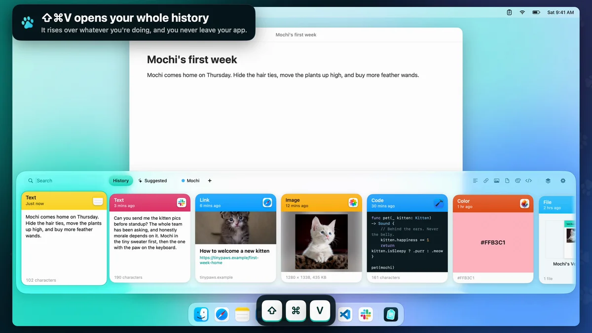

# Clipboard

A native macOS clipboard manager. It saves everything you copy to a searchable shelf at the bottom of the screen.



The full demo runs about 2½ minutes, with no sound. It's rendered from the app's real views, with scripted input and sample clips. There's also a [1080p download](https://github.com/alicin/clipboard/raw/main/demo-assets/demo.mp4) (43 MB).

https://github.com/user-attachments/assets/05a479f7-0001-4dbf-ab6f-49d3df278835

Requires macOS 15.4 or later. Everything stays on your Mac.

## Build and install

```bash
scripts/build-app.sh --install
open ~/Applications/Clipboard.app
```

Clipboard runs from the menu bar. On first launch it opens Settings so you can allow direct paste.

## Permissions

Clipboard works without any permission, but choosing a clip then only copies it and you press ⌘V yourself. To drop clips straight into the app you're using, and to let the Paste Stack notice each ⌘V, click **Allow access** in Settings and turn Clipboard on in the Accessibility list.

`scripts/build-app.sh` signs with a stable certificate so this permission survives rebuilds: the "Gremlin Code Signing" certificate if it's in your login keychain, or whatever `CLIPBOARD_SIGN_IDENTITY` names. With neither, it signs ad-hoc with a requirement that names only the bundle identifier, which also survives rebuilds, but any ad-hoc app claiming that identifier would inherit the permission.

## Using the shelf

| Keys | Action |
| --- | --- |
| ⇧⌘V | Open or close the shelf (change it in Settings) |
| Type | Search everything, including text inside images |
| ← → | Move between clips (⌘← ⌘→ for first and last) |
| ↩ | Paste |
| ⇧↩ | Paste as plain text, or with formatting if plain text is your default |
| ⌘1 to ⌘9 | Paste a visible clip (hold ⌘ to see the numbers) |
| Space | Preview |
| ⌘C | Copy without pasting |
| ⌘⌫ | Delete |
| ⇥ ⇧⇥ | Move between History, Suggested and your pinboards |
| ⎋ | Close the preview, clear the search, then close the shelf |

Hover a clip for quick pin, copy and delete buttons, or right-click it for everything else. You can also drag a clip onto a pinboard's name or into another app.

**Paste Stack (⇧⌘C):** copy several things in order, then each ⌘V pastes the next one, oldest first.

**Suggested:** ranks clips for the app you're in, using what you've pasted there before, what you just copied elsewhere, and what came from that app. It's a local ranking with no AI model.

## Privacy

- Clips are stored in `~/Library/Application Support/com.bunniesinc.clipboard`, readable only by your account. They aren't encrypted beyond your disk's own encryption.
- Copies that apps mark as concealed or transient are never read, and password manager apps are ignored by default.
- Text that looks like an API key, token, private key or card number is skipped by default. In Settings > Privacy you can choose **Hide** to save it but show it as dots, or **Show** to save it like any other clip. Pasting a hidden clip gives the real text. This matches known formats, so it won't catch everything.
- AI tools never get text that looks like a secret, and Clipboard never fetches a preview for a link that contains one.
- Link previews are off by default, because fetching one contacts the site as soon as you copy its link.

## AI tools

`clipboard-mcp`, bundled inside the app, is a read-only [MCP](https://modelcontextprotocol.io) server. Sharing is off until you choose pinboards or your entire history in Settings > AI Tools, which also shows the setup for each tool:

```bash
claude mcp add clipboard -- ~/Applications/Clipboard.app/Contents/MacOS/clipboard-mcp
```

## Not included

iPhone and iPad apps, iCloud sync and shared team pinboards are left out. Suggested uses local ranking in place of Apple Intelligence.

## Development

```bash
DEVELOPER_DIR=/Applications/Xcode.app/Contents/Developer swift test
scripts/ui_test.py
```

`swift test` needs Xcode's toolchain for Swift Testing. `scripts/ui_test.py` drives a debug build through its real UI, off-screen, with a private pasteboard, separate preferences and no global hotkeys, so it doesn't touch your clipboard or interrupt you. Direct paste and detecting a real ⌘V need Accessibility access, so check those by hand.

| Path | Contents |
| --- | --- |
| `Sources/ClipboardCore` | Storage, search, classification, MCP server |
| `Sources/Clipboard` | The app: capture, hotkeys, shelf, stack, settings |
| `Sources/clipboard-mcp` | MCP server executable |
| `scripts/make-icon.swift` | Draws the app icon |
| `scripts/make-demo.sh` | Renders the demo video from the real views, with the kittens in `demo-assets` |
| `Sources/Clipboard/Demo` | The demo's stage, script and compositor, compiled into debug builds only |
