> [!WARNING]
> **Allergy notice: this repo contains AI.** Every line was written by [Claude](https://claude.com/claude-code), while a human supplied the taste and notes like "a lil easy on the glow." If AI-written code makes your eye twitch, please move along, no hard feelings. We hear small-batch, hand-typed clipboard managers are lovely this time of year.

<div align="center">

<br>

<p>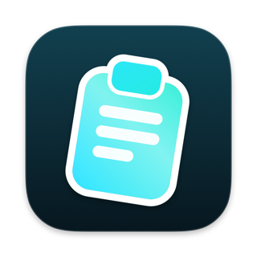</p>

<p>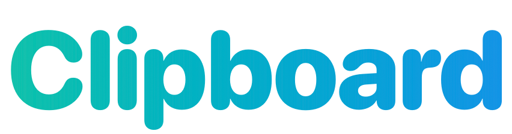</p>

### Everything you copy, one keystroke away.

A native clipboard manager for your Mac. Press <kbd>⇧</kbd> <kbd>⌘</kbd> <kbd>V</kbd> and your whole history<br>rises over whatever you're doing, ready to search, preview and paste.

<br>

<a href="#build-and-install"></a>

<sub>Requires macOS 15.4 or later</sub>

<br>

https://github.com/user-attachments/assets/72422053-3c02-4b4e-b98d-bb76a7312268

<sub>The full tour, about 2½ minutes with no sound. It's rendered from the app's real views, with scripted input and sample clips. There's also a <a href="https://github.com/alicin/clipboard/raw/main/demo-assets/demo.mp4">1080p download</a> (44 MB).</sub>

<br>

<table>
<tr>
<td width="33%" valign="top" align="center"><b>Stays on your Mac</b><br><br>No account, and no cloud unless you turn on sync. Your history lives in a folder only your account can read.</td>
<td width="33%" valign="top" align="center"><b>Made for the keyboard</b><br><br>Arrows to move, Return to paste, just type to search. Your hands never leave the keys.</td>
<td width="33%" valign="top" align="center"><b>Feels like macOS</b><br><br>Built in Swift with AppKit and SwiftUI. It lives in your menu bar and follows your appearance.</td>
</tr>
</table>

<br>

## Your whole history, one shortcut away

Copy anything in any app and it's saved. Press <kbd>⇧</kbd> <kbd>⌘</kbd> <kbd>V</kbd> and the shelf rises over what you're doing, so you never leave your app.

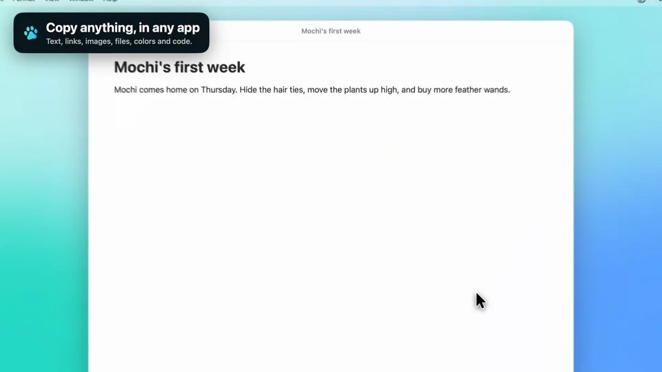

<br>

## Every clip looks like what it is

Links, images, code, colors and files each get their own card, in the color of the app they came from. Arrow keys glide between them.

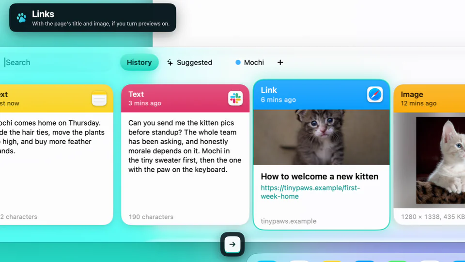

<br>

## Paste right where you left off

Press <kbd>↩︎</kbd> and the shelf gets out of the way while the clip lands in your app. Text, links and photos all paste the same way, and <kbd>⇧</kbd> <kbd>↩︎</kbd> pastes plain text.

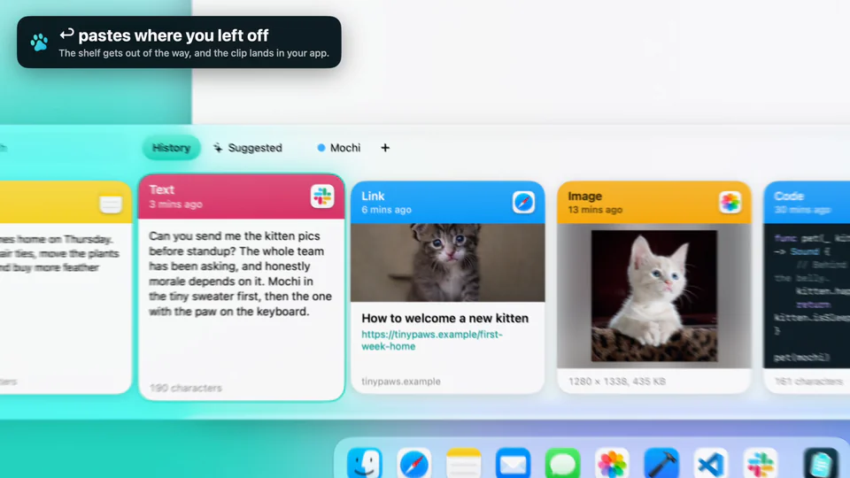

<br>

## Find it by typing

Just start typing. Search covers everything you've ever copied, including the text inside images. Or click a filter to see only links, images, files, colors or code.

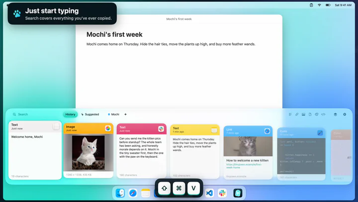 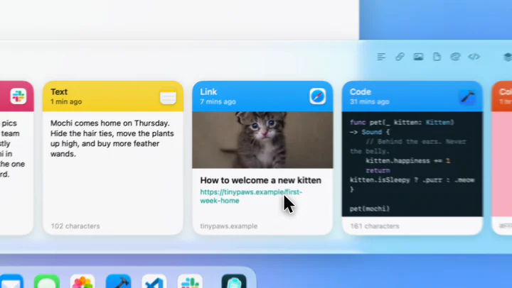

<br>

## Look closer, or skip straight to it

Press <kbd>Space</kbd> to read a whole clip or play a video, and keep arrowing while it's open. Hold <kbd>⌘</kbd> to number the clips you can see, then press <kbd>1</kbd> to <kbd>9</kbd> to paste one.

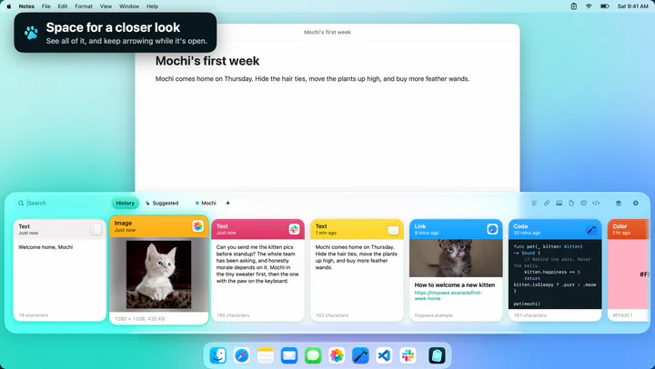 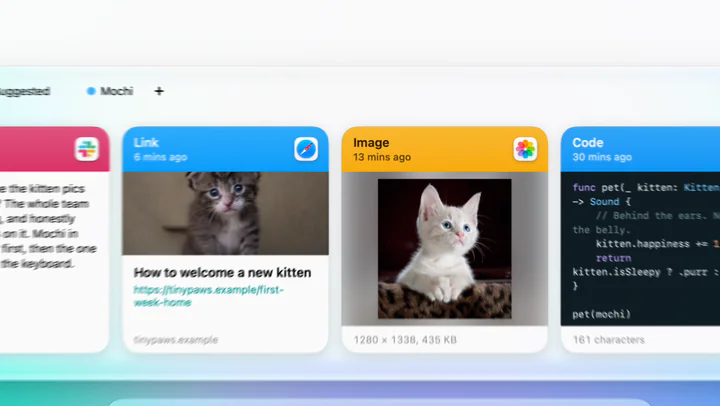

<br>

## Keep what matters on a pinboard

Drag a clip onto a pinboard's name, or pin it from its card. Pinned clips stay when old history gets cleaned up, and <kbd>⇥</kbd> flips between boards.

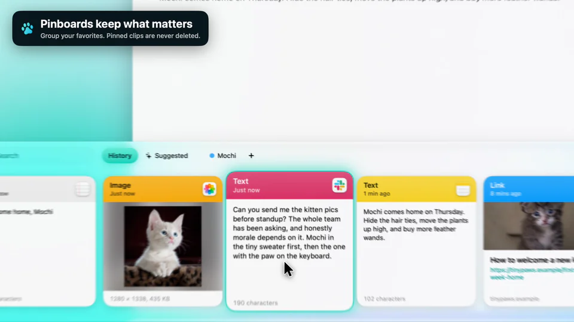

<br>

## Let it guess, or line things up

Suggested ranks clips for the app you're in, using what you've pasted there before. Paste Stack (<kbd>⇧</kbd> <kbd>⌘</kbd> <kbd>C</kbd>) collects several copies, then each <kbd>⌘</kbd> <kbd>V</kbd> pastes the next one, oldest first.

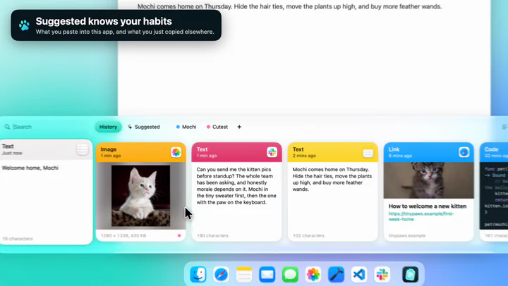 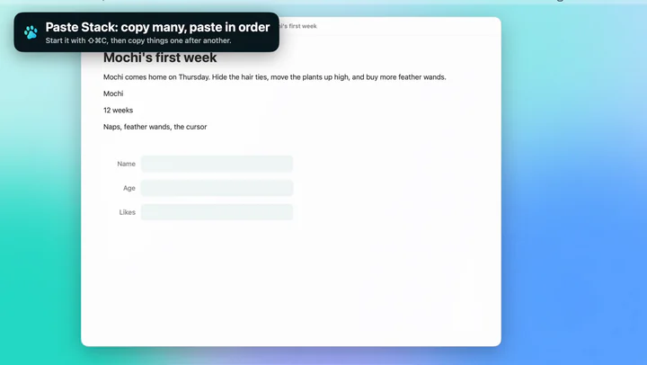

<br>

## Your clipboard stays yours

Password managers are ignored by default. Text that looks like a key or token can be skipped, shown as dots, or kept as it is, and hidden clips still paste in full.

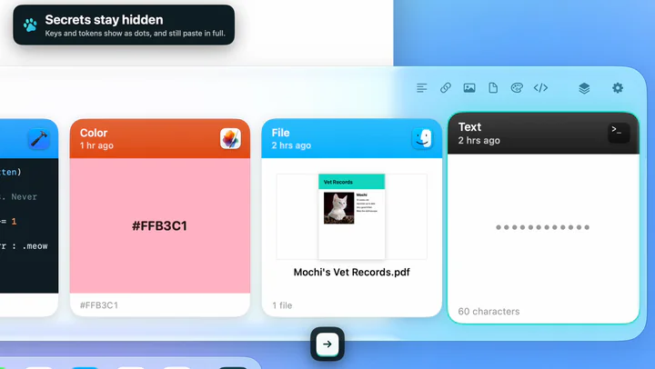 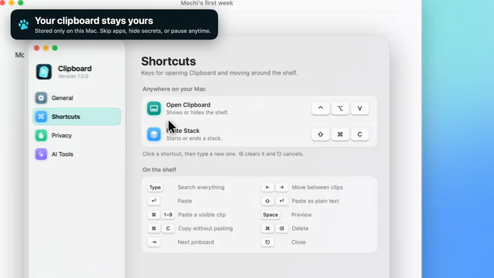

<br>

## Sync, on your terms

It's off until you turn it on. iCloud Drive syncs your Macs with nothing to set up, and Google Drive uses your own Google app, so no server of ours is ever involved. Either way, clips are encrypted before they leave your Mac.

<br>

## Your AI tools can search it too

A read-only MCP server lets tools like Claude search what you choose to share: nothing, your pinboards, or everything. They can't change your clips, and they never get text that looks like a secret.

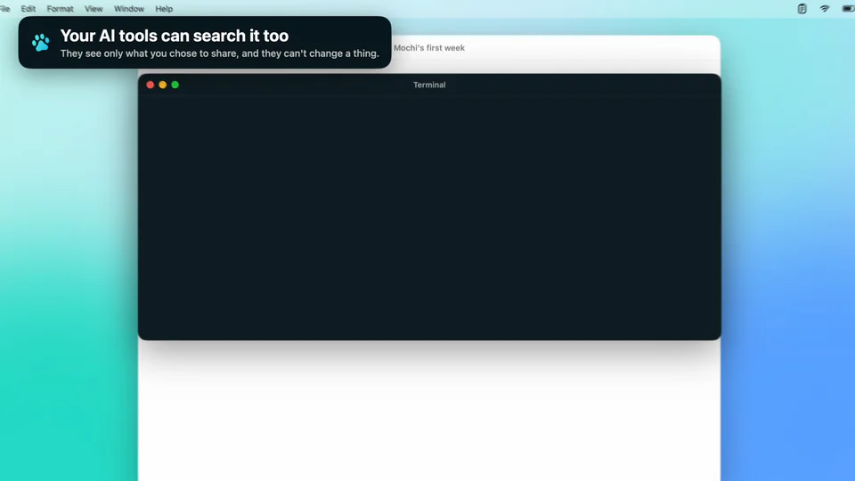

<br>

## Settings that stay out of your way

Allow direct paste once, change any shortcut and see what you've saved, all in one place. It follows your Mac into dark mode too.

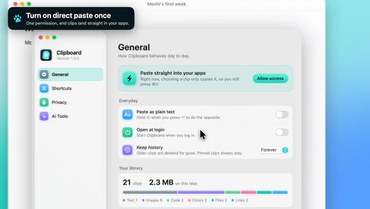 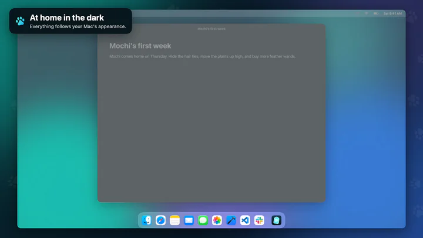

<br>

</div>

## Build and install

```bash
scripts/build-app.sh --install
open ~/Applications/Clipboard.app
```

Clipboard runs from the menu bar. On first launch it opens Settings so you can allow direct paste.

## Permissions

Clipboard works without any permission, but choosing a clip then only copies it and you press ⌘V yourself. To drop clips straight into the app you're using, and to let the Paste Stack notice each ⌘V, click **Allow access** in Settings and turn Clipboard on in the Accessibility list.

`scripts/build-app.sh` signs with a stable certificate so this permission survives rebuilds: whatever `CLIPBOARD_SIGN_IDENTITY` names, or else the first usable code signing certificate in your login keychain. With neither, it signs ad-hoc with a requirement that names only the bundle identifier, which also survives rebuilds, but any ad-hoc app claiming that identifier would inherit the permission.

## Using the shelf

| Keys | Action |
| --- | --- |
|  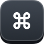  | Open or close the shelf (change it in Settings) |
| 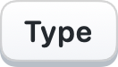 | Search everything, including text inside images |
| 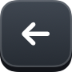  | Move between clips |
|   or   | Jump to the first or last clip |
| 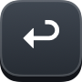 | Paste |
|   | Paste as plain text, or with formatting if plain text is your default |
|   to   | Paste a visible clip (hold ⌘ to see the numbers) |
|  | Preview a clip, and play it if it's a video, audio file or animated image |
|   | Copy without pasting |
|   | Delete |
|  or   | Move between History, Suggested and your pinboards |
|  | Close the preview, clear the search, then close the shelf |

Hover a clip for quick pin, copy and delete buttons, or right-click it for everything else. You can also drag a clip onto a pinboard's name or into another app.

**Paste Stack (<kbd>⇧</kbd> <kbd>⌘</kbd> <kbd>C</kbd>):** copy several things in order, then each <kbd>⌘</kbd> <kbd>V</kbd> pastes the next one, oldest first.

**Suggested:** ranks clips for the app you're in, using what you've pasted there before, what you just copied elsewhere, and what came from that app. It's a local ranking with no AI model.

## Privacy

- Clips are stored in `~/Library/Application Support/com.bunniesinc.clipboard`, readable only by your account. They aren't encrypted beyond your disk's own encryption.
- Copies that apps mark as concealed or transient are never read, and password manager apps are ignored by default.
- Text that looks like an API key, token, private key or card number is skipped by default. In Settings > Privacy you can choose **Hide** to save it but show it as dots, or **Show** to save it like any other clip. Pasting a hidden clip gives the real text. This matches known formats, so it won't catch everything.
- AI tools never get text that looks like a secret, and Clipboard never fetches a preview for a link that contains one.
- Link previews are on by default, so copying a link contacts that site for its title, image and icon. Private addresses and links that look single-use, like password resets, are skipped, and you can turn previews off in Settings > Privacy.

## Sync

Sync is off by default. Choose where it goes in Settings > Sync:

| Mode | Works between | Setup |
| --- | --- | --- |
| Off | Nothing leaves this Mac | None |
| iCloud Drive | Your Macs | A passphrase |
| Google Drive | Your Macs today, other platforms once they have a client | Your own free Google app, and a passphrase |

Clips are encrypted with your passphrase before they leave the Mac, so neither Apple nor Google can read them, and nobody can recover the passphrase for you. Files, text that looks like a secret and clips over 25 MB never sync. Deleting a clip deletes it on your other devices too, but your retention setting only applies to the Mac it's set on.

Google Drive uses a client you create yourself, because Clipboard has no servers and no Google app of its own. Settings walks you through it. It can only reach its own hidden folder in your Drive, not your files. Use the same client on every device, and click **Publish app** when you set it up, or Google signs you out every 7 days.

iCloud sync here is a folder in iCloud Drive rather than Apple's CloudKit, which needs a paid developer account. The format is plain and documented in [docs/sync-format.md](docs/sync-format.md), so a client on another platform can join.

## AI tools

`clipboard-mcp`, bundled inside the app, is a read-only [MCP](https://modelcontextprotocol.io) server. Sharing is off until you choose pinboards or your entire history in Settings > AI Tools, which also shows the setup for each tool:

```bash
claude mcp add clipboard -- ~/Applications/Clipboard.app/Contents/MacOS/clipboard-mcp
```

## Not included

iPhone and iPad apps and shared team pinboards are left out. Suggested uses local ranking in place of Apple Intelligence.

<details>
<summary><b>Development</b></summary>

```bash
DEVELOPER_DIR=/Applications/Xcode.app/Contents/Developer swift test
scripts/ui_test.py
```

`swift test` needs Xcode's toolchain for Swift Testing. `scripts/ui_test.py` drives a debug build through its real UI, off-screen, with a private pasteboard, separate preferences and no global hotkeys, so it doesn't touch your clipboard or interrupt you. Direct paste and detecting a real ⌘V need Accessibility access, so check those by hand.

| Path | Contents |
| --- | --- |
| `Sources/ClipboardCore` | Storage, search, classification, MCP server |
| `Sources/Clipboard` | The app: capture, hotkeys, shelf, stack, settings |
| `Sources/clipboard-mcp` | MCP server executable |
| `scripts/make-icon.swift` | Draws the app icon |
| `scripts/make-readme-art.swift` | Draws this page's title, button and key caps |
| `scripts/make-demo.sh` | Renders the demo video from the real views, with the kittens in `demo-assets` |
| `scripts/make-clips.py` | Cuts this page's clips out of the demo video |
| `Sources/Clipboard/Demo` | The demo's stage, script and compositor, compiled into debug builds only |

</details>
